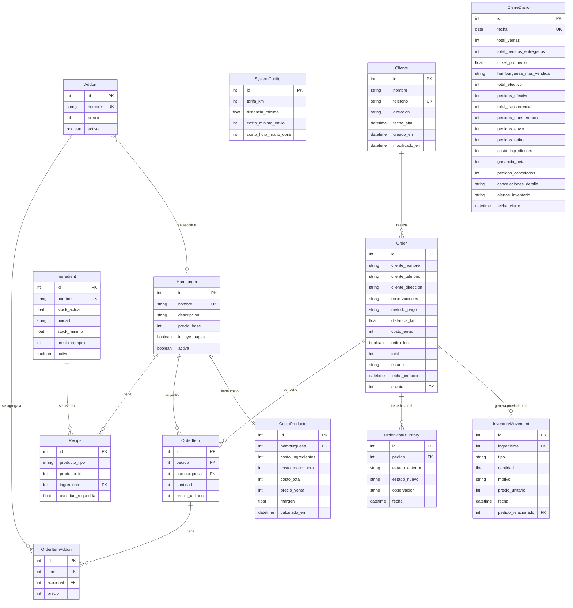

# ESQUEMA DE BASE DE DATOS — ENTRE BRASAS

**Fecha:** 17/09/2026
**Motor:** PostgreSQL (producción) / SQLite (desarrollo)
**Framework:** Django ORM

---

## Resumen

| Categoría | Tablas |
|-----------|--------|
| Existentes | 10 |
| Nuevas (a implementar) | 3 |
| **Total** | **13** |

| App | Tabla | Estado |
|-----|-------|--------|
| menu | Hamburger | Existe |
| menu | Addon | Existe |
| inventory | Ingredient | Existe |
| inventory | Recipe | Existe |
| inventory | InventoryMovement | Existe |
| orders | Order | Existe (+modificación) |
| orders | OrderItem | Existe |
| orders | OrderItemAddon | Existe |
| orders | OrderStatusHistory | Existe |
| config | SystemConfig | Existe |
| clients | Cliente | **Nueva** |
| closing | CierreDiario | **Nueva** |
| costs | CostoProducto | **Nueva** |

---

## TABLAS EXISTENTES

### menu.Hamburger

| Campo | Tipo | Constraints | Descripción |
|-------|------|-------------|-------------|
| id | BigAutoField | PK | — |
| nombre | CharField(100) | UNIQUE, NOT NULL | Nombre de la hamburguesa |
| descripcion | TextField | NOT NULL | Descripción detallada |
| precio_base | PositiveIntegerField | NOT NULL | Precio en pesos argentinos |
| incluye_papas | BooleanField | default=True | Si incluye papas fritas |
| activa | BooleanField | default=True | Si está activa en el menú |

**Orden por defecto:** `nombre`
**Verbose:** Hamburguesa / Hamburguesas

---

### menu.Addon

| Campo | Tipo | Constraints | Descripción |
|-------|------|-------------|-------------|
| id | BigAutoField | PK | — |
| nombre | CharField(100) | UNIQUE, NOT NULL | Nombre del adicional |
| precio | PositiveIntegerField | NOT NULL | Precio en pesos argentinos |
| activo | BooleanField | default=True | Si está activo |

**Relación:** `productos` = ManyToManyField → Hamburger (related_name=`adicionales`)
**Orden por defecto:** `nombre`
**Verbose:** Adicional / Adicionales

---

### inventory.Ingredient

| Campo | Tipo | Constraints | Descripción |
|-------|------|-------------|-------------|
| id | BigAutoField | PK | — |
| nombre | CharField(100) | UNIQUE, NOT NULL | Nombre del ingrediente |
| stock_actual | DecimalField(10,2) | default=0 | Stock actual |
| unidad | CharField(10) | choices=UNIDADES | Unidad de medida |
| stock_minimo | DecimalField(10,2) | NOT NULL | Stock mínimo requerido |
| precio_compra | PositiveIntegerField | default=0 | Precio última compra (pesos) |
| activo | BooleanField | default=True | Si está activo |

**Choices `unidad`:**

| Valor | Display |
|-------|---------|
| kg | Kilogramos |
| g | Gramos |
| L | Litros |
| mL | Mililitros |
| unidades | Unidades |

**Propiedad:** `stock_bajo` → `True` si `stock_actual < stock_minimo`
**Orden por defecto:** `nombre`
**Verbose:** Ingrediente / Ingredientes

---

### inventory.Recipe

| Campo | Tipo | Constraints | Descripción |
|-------|------|-------------|-------------|
| id | BigAutoField | PK | — |
| producto_tipo | CharField(10) | choices=TIPOS_PRODUCTO | Tipo de producto |
| producto_id | PositiveIntegerField | — | ID del producto (polymórfico) |
| ingrediente | ForeignKey | → Ingredient, CASCADE | Ingrediente de la receta |
| cantidad_requerida | DecimalField(10,2) | — | Cantidad necesaria |

**Choices `producto_tipo`:**

| Valor | Display |
|-------|---------|
| hamburger | Hamburguesa |
| addon | Adicional |

**Constraints:** `unique_together = ['producto_tipo', 'producto_id', 'ingrediente']`
**Orden por defecto:** `producto_tipo`, `producto_id`
**Verbose:** Receta / Recetas

---

### inventory.InventoryMovement

| Campo | Tipo | Constraints | Descripción |
|-------|------|-------------|-------------|
| id | BigAutoField | PK | — |
| ingrediente | ForeignKey | → Ingredient, CASCADE | Ingrediente movido |
| tipo | CharField(10) | choices=TIPOS | Entrada o salida |
| cantidad | DecimalField(10,2) | — | Cantidad movida |
| motivo | CharField(255) | — | Razón del movimiento |
| precio_unitario | PositiveIntegerField | default=0 | Precio por unidad |
| fecha | DateTimeField | auto_now_add | Fecha del movimiento |
| pedido_relacionado | ForeignKey | → Order, SET_NULL, nullable | Pedido asociado (si es por stock) |

**Choices `tipo`:**

| Valor | Display |
|-------|---------|
| entrada | Entrada |
| salida | Salida |

**Orden por defecto:** `-fecha` (más reciente primero)
**Verbose:** Movimiento de Inventario / Movimientos de Inventario

---

### orders.Order

| Campo | Tipo | Constraints | Descripción |
|-------|------|-------------|-------------|
| id | BigAutoField | PK | — |
| cliente_nombre | CharField(200) | — | Nombre del cliente |
| cliente_telefono | CharField(50) | — | Teléfono del cliente |
| cliente_direccion | CharField(300) | — | Dirección de entrega |
| observaciones | TextField | nullable, blank | Observaciones del pedido |
| metodo_pago | CharField(20) | choices=METODOS_PAGO | Método de pago |
| distancia_km | DecimalField(5,2) | default=0 | Distancia de envío en km |
| costo_envio | PositiveIntegerField | default=0 | Costo del envío en pesos |
| retiro_local | BooleanField | default=False | Si es retiro en local |
| total | PositiveIntegerField | default=0 | Total del pedido en pesos |
| estado | CharField(20) | choices=ESTADOS, default='pendiente' | Estado actual |
| fecha_creacion | DateTimeField | auto_now_add | Fecha de creación |

**Choices `metodo_pago`:**

| Valor | Display |
|-------|---------|
| efectivo | Efectivo |
| transferencia | Transferencia/QR |

**Choices `estado`:**

| Valor | Display | Flujo |
|-------|---------|-------|
| pendiente | Pendiente | → En preparación |
| en_preparacion | En preparación | → En camino |
| en_camino | En camino | → Entregado |
| entregado | Entregado | (terminal) |
| cancelado | Cancelado | (terminal) |

**Orden por defecto:** `fecha_creacion`
**Verbose:** Pedido / Pedidos

---

### orders.OrderItem

| Campo | Tipo | Constraints | Descripción |
|-------|------|-------------|-------------|
| id | BigAutoField | PK | — |
| pedido | ForeignKey | → Order, CASCADE | Pedido al que pertenece |
| hamburguesa | ForeignKey | → Hamburger, CASCADE | Hamburguesa pedida |
| cantidad | PositiveIntegerField | default=1 | Cantidad pedida |
| precio_unitario | PositiveIntegerField | — | Precio al momento del pedido |

**Propiedad:** `subtotal` → `precio_unitario * cantidad`
**Verbose:** Item del Pedido / Items del Pedido

---

### orders.OrderItemAddon

| Campo | Tipo | Constraints | Descripción |
|-------|------|-------------|-------------|
| id | BigAutoField | PK | — |
| item | ForeignKey | → OrderItem, CASCADE | Item al que pertenece |
| adicional | ForeignKey | → Addon, CASCADE | Adicional elegido |
| precio | PositiveIntegerField | — | Precio al momento del pedido |

**Verbose:** Adicional del Item / Adicionales del Item

---

### orders.OrderStatusHistory

| Campo | Tipo | Constraints | Descripción |
|-------|------|-------------|-------------|
| id | BigAutoField | PK | — |
| pedido | ForeignKey | → Order, CASCADE | Pedido asociado |
| estado_anterior | CharField(20) | — | Estado previo |
| estado_nuevo | CharField(20) | — | Estado nuevo |
| observacion | TextField | nullable, blank | Observación del cambio |
| fecha | DateTimeField | auto_now_add | Fecha del cambio |

**Orden por defecto:** `-fecha`
**Verbose:** Historial de Estado / Historial de Estados

**Nota:** Los campos `estado_anterior` y `estado_nuevo` deberían tener `choices=Order.ESTADOS` para que Django genere los métodos `get_estado_anterior_display()` y `get_estado_nuevo_display()`.

---

### config.SystemConfig (Singleton)

| Campo | Tipo | Constraints | Descripción |
|-------|------|-------------|-------------|
| id | BigAutoField | PK | — |
| tarifa_km | PositiveIntegerField | default=500 | Costo por kilómetro (pesos) |
| distancia_minima | DecimalField(5,2) | default=1 | Distancia mínima para cobrar envío (km) |
| costo_minimo_envio | PositiveIntegerField | default=1000 | Costo mínimo de envío (pesos) |
| costo_hora_mano_obra | PositiveIntegerField | default=2500 | Costo hora de mano de obra (pesos) |

**Comportamiento:**
- Solo existe una fila (pk=1)
- `save()` fuerza `pk=1`
- `delete()` no hace nada (no se puede borrar)
- `get_config()` crea o retorna la instancia

**Verbose:** Configuración del Sistema / Configuraciones del Sistema

---

## TABLAS NUEVAS (a implementar)

### Cliente

| Campo | Tipo | Constraints | Descripción |
|-------|------|-------------|-------------|
| id | BigAutoField | PK | — |
| nombre | CharField(200) | NOT NULL | Nombre completo |
| telefono | CharField(50) | UNIQUE, NOT NULL | Teléfono (usado como identificador) |
| direccion | CharField(300) | NOT NULL | Dirección principal |
| fecha_alta | DateTimeField | auto_now_add | Fecha de registro |
| creado_en | DateTimeField | auto_now_add | Auditoría: creación |
| modificado_en | DateTimeField | auto_now | Auditoría: última modificación |

**Relaciones:**
- `Order` → FK `cliente` (opcional, SET_NULL)

**Orden por defecto:** `-fecha_alta` (más recientes primero)
**Verbose:** Cliente / Clientes

**Nota:** Se usa `telefono` como identificador único porque es el campo que el usuario conoce y comparte al hacer pedidos.

---

### CierreDiario

| Campo | Tipo | Constraints | Descripción |
|-------|------|-------------|-------------|
| id | BigAutoField | PK | — |
| fecha | DateField | NOT NULL | Fecha del día cerrado |
| total_ventas | PositiveIntegerField | default=0 | Total facturado en pesos |
| total_pedidos_entregados | PositiveIntegerField | default=0 | Cantidad de pedidos entregados |
| ticket_promedio | DecimalField(10,2) | default=0 | Promedio de gasto por cliente |
| hamburguesa_mas_vendida | CharField(200) | blank | Nombre de la más pedida |
| total_efectivo | PositiveIntegerField | default=0 | Total cobrado en efectivo |
| pedidos_efectivo | PositiveIntegerField | default=0 | Cantidad de pedidos en efectivo |
| total_transferencia | PositiveIntegerField | default=0 | Total cobrado por transferencia/QR |
| pedidos_transferencia | PositiveIntegerField | default=0 | Cantidad de pedidos por transferencia |
| pedidos_envio | PositiveIntegerField | default=0 | Pedidos enviados a domicilio |
| pedidos_retiro | PositiveIntegerField | default=0 | Pedidos retirados en local |
| costo_ingredientes | PositiveIntegerField | default=0 | Costo total de ingredientes usados |
| ganancia_neta | IntegerField | default=0 | Ventas - Costo ingredientes |
| pedidos_cancelados | PositiveIntegerField | default=0 | Cantidad de pedidos cancelados |
| cancelaciones_detalle | JSONField | default=list | Detalle de cancelaciones [{pedido_id, cliente, motivo}] |
| alertas_inventario | JSONField | default=list | Ingredientes con stock bajo [{nombre, stock_actual, stock_minimo}] |
| fecha_cierre | DateTimeField | auto_now_add | Fecha y hora del cierre |

**Constraints:**
- `unique_together = ['fecha']` (un solo cierre por día)

**Orden por defecto:** `-fecha` (más reciente primero)
**Verbose:** Cierre Diario / Cierres Diarios

**Nota:** Este modelo es un **snapshot**. No tiene FK a otras tablas. Se genera automáticamente al día siguiente con un management command o tarea programada.

---

### CostoProducto

| Campo | Tipo | Constraints | Descripción |
|-------|------|-------------|-------------|
| id | BigAutoField | PK | — |
| hamburguesa | ForeignKey | → Hamburger, CASCADE | Hamburguesa asociada |
| costo_ingredientes | PositiveIntegerField | default=0 | Costo total de ingredientes (pesos) |
| costo_mano_obra | PositiveIntegerField | default=0 | Costo de mano de obra (pesos) |
| costo_total | PositiveIntegerField | default=0 | Costo total de producción (pesos) |
| precio_venta | PositiveIntegerField | default=0 | Precio de venta actual (pesos) |
| margen | DecimalField(5,2) | default=0 | Margen de ganancia (%) |
| calculado_en | DateTimeField | auto_now_add | Última vez que se calculó |

**Relaciones:**
- `hamburguesa` → FK a Hamburger

**Constraints:**
- `unique_together = ['hamburguesa']` (un registro de costo por hamburguesa)

**Verbose:** Costo de Producto / Costos de Productos

**Nota:** Se recalcula manualmente con un botón. El cálculo usa:
- `costo_ingredientes`: suma de (cantidad_requerida × precio_compra) de cada ingrediente en la receta
- `costo_mano_obra`: se calcula según `SystemConfig.costo_hora_mano_obra`
- `margen`: `((precio_venta - costo_total) / precio_venta) × 100`

---

## MODIFICACIONES A TABLAS EXISTENTES

### orders.Order — Agregar FK a Cliente

| Campo | Tipo | Constraints | Descripción |
|-------|------|-------------|-------------|
| cliente | ForeignKey | → Cliente, SET_NULL, nullable, blank | Cliente asociado (opcional) |

**Nota:** Se mantiene `cliente_nombre`, `cliente_telefono` y `cliente_direccion` como campos de texto para no romper pedidos históricos. La FK es opcional.

---

## DIAGRAMA DE RELACIONES

```
Cliente (nuevo)
  │
  └── Order (modificar: agregar FK cliente)
        │
        ├── OrderItem ─────── Hamburger ──── Recipe ──── Ingredient
        │     │                                          │
        │     └── OrderItemAddon ── Addon                 │
        │                                                  │
        ├── OrderStatusHistory                             │
        │                                                  │
        └── InventoryMovement ─────────────────────────────┘

Hamburger ──── CostoProducto (nuevo)

SystemConfig (singleton, sin relaciones)

CierreDiario (nuevo, snapshot sin FK)
```

### Relaciones en texto

| Relación | Tipo | Card. | Descripción |
|----------|------|-------|-------------|
| Cliente → Order | FK en Order | 1:N | Un cliente puede tener muchos pedidos |
| Order → OrderItem | FK en OrderItem | 1:N | Un pedido tiene muchos items |
| Hamburger → OrderItem | FK en OrderItem | 1:N | Una hamburguesa aparece en muchos items |
| OrderItem → OrderItemAddon | FK en OrderItemAddon | 1:N | Un item tiene muchos adicionales |
| Addon → OrderItemAddon | FK en OrderItemAddon | 1:N | Un adicional aparece en muchos items |
| Order → OrderStatusHistory | FK en History | 1:N | Un pedido tiene historial de estados |
| Hamburger → Recipe | FK en Recipe | 1:N | Una hamburguesa tiene muchos ingredientes |
| Ingredient → Recipe | FK en Recipe | 1:N | Un ingrediente aparece en muchas recetas |
| Ingredient → InventoryMovement | FK en Movement | 1:N | Un ingrediente tiene muchos movimientos |
| Order → InventoryMovement | FK en Movement (nullable) | 1:N | Un pedido puede tener movimientos de stock |
| Hamburger → CostoProducto | FK en CostoProducto | 1:1 | Cada hamburguesa tiene un registro de costo |
| Addon → Hamburger | M2M | N:N | Un adicional va con varias hamburguesas |

---

## NOTAS DE IMPLEMENTACIÓN

### Auditoría
- Solo las tablas **nuevas** (Cliente, CierreDiario, CostoProducto) llevan campos `creado_en` y `modificado_en`
- Las tablas existentes mantienen sus campos de fecha actuales

### CierreDiario
- Se genera **automáticamente** al día siguiente (management command o celery beat)
- También puede generarse manualmente con un botón
- Es un snapshot: no tiene FK, no depende de otras tablas
- Los campos JSON (`cancelaciones_detalle`, `alertas_inventario`) almacenan datos atómicos del día

### Reportes
- Se calculan en **tiempo real** con queries a las tablas existentes
- No se crea tabla dedicada para reportes
- Las queries principales se ejecutan sobre `Order`, `OrderItem`, `InventoryMovement`

### Costos
- `CostoProducto` se recalcula **manualmente** con un botón
- Usa los precios de ingredientes actuales y la configuración de mano de obra
- El campo `margen` se expresa como porcentaje (ej: 45.50 = 45.50%)

### Normalización
- `Recipe` usa `producto_tipo` + `producto_id` (polymórfico) en lugar de FK directa
- `Order` mantiene campos de texto del cliente junto con la FK (compatibilidad histórica)
- `SystemConfig` es singleton (solo una fila, pk=1)

### Migración de datos
- `Cliente` se crea a partir de pedidos existentes, agrupando por `cliente_telefono`
- Los pedidos existentes obtienen FK `cliente=NULL` (se asocian después)

---

## RESUMEN DE CAMPOS POR TABLA

| Tabla | Campos | PK | FK | M2M | JSON |
|-------|--------|----|----|-----|------|
| Hamburger | 6 | id | — | — | — |
| Addon | 4 | id | — | productos→Hamburger | — |
| Ingredient | 7 | id | — | — | — |
| Recipe | 5 | id | ingrediente→Ingredient | — | — |
| InventoryMovement | 8 | id | ingrediente→Ingredient, pedido_relacionado→Order | — | — |
| Order | 13 | id | cliente→Cliente (nuevo) | — | — |
| OrderItem | 5 | id | pedido→Order, hamburguesa→Hamburger | — | — |
| OrderItemAddon | 4 | id | item→OrderItem, adicional→Addon | — | — |
| OrderStatusHistory | 6 | id | pedido→Order | — | — |
| SystemConfig | 5 | id | — | — | — |
| **Cliente** (nuevo) | 7 | id | — | — | — |
| **CierreDiario** (nuevo) | 18 | id | — | — | cancelaciones_detalle, alertas_inventario |
| **CostoProducto** (nuevo) | 8 | id | hamburguesa→Hamburger | — | — |
| **Total** | **96** | | | | |

---

## DIAGRAMA MERMAID ER


